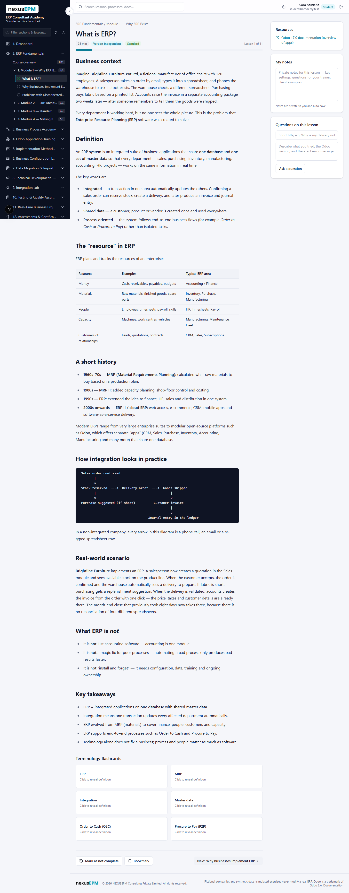
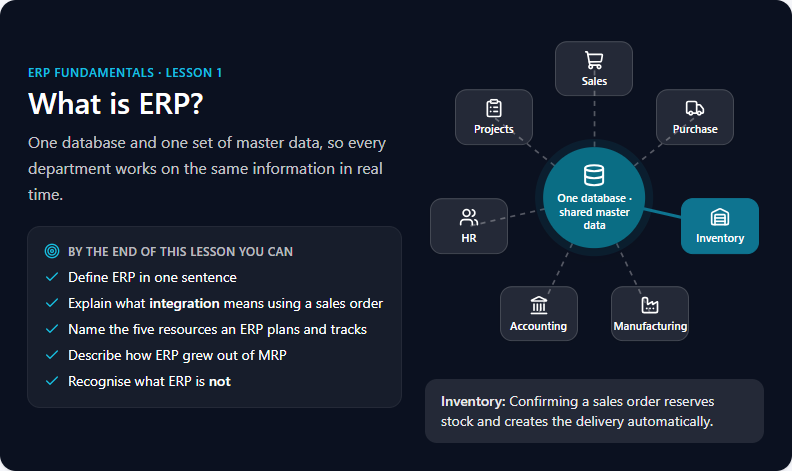
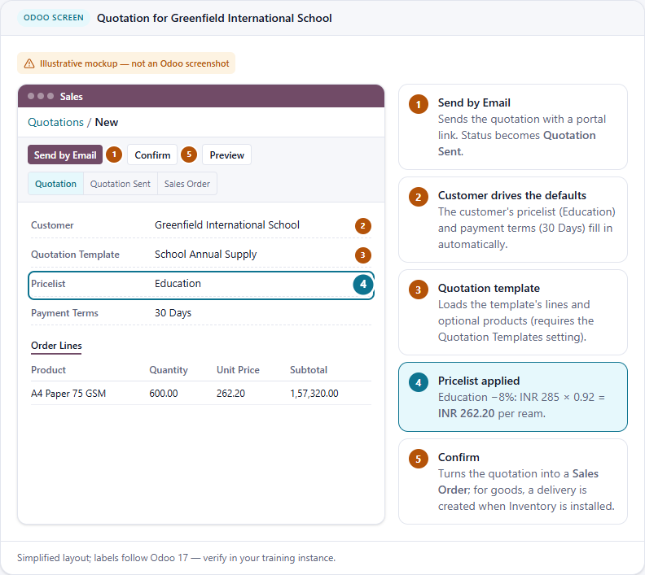
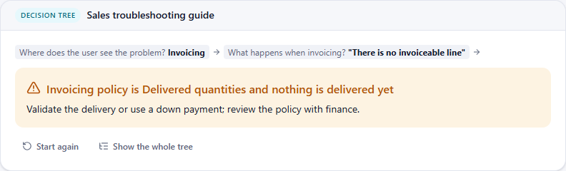

# Visual learning upgrade — audit, plan, design system and prototype

Goal: turn a text-heavy training portal into a visual, practical learning experience
**without rebuilding it** — keep every course, lesson, assessment, permission and
learner's progress, and make each concept understandable through the right diagram,
example or interactive check.

> **Platform note.** The brief was written for an Odoo-based portal. This academy is a
> Next.js application (Odoo is the subject it teaches), so the equivalents are: lesson
> Markdown + React components instead of QWeb templates, `src/content/**` + the lesson
> editor instead of Odoo records, and no database schema change at all.

| Document | Purpose |
|---|---|
| [visual-blocks.md](visual-blocks.md) | Authoring guide — every visual block type, JSON shape, when to use it |
| [enhancement-matrix.md](enhancement-matrix.md) | Lesson-by-lesson enhancement matrix (105 lessons + 6 processes + 5 scenarios, 362 proposals, P1–P3, rollout waves) |
| [napkin-prompts.md](napkin-prompts.md) | 44 Napkin AI prompts with export-and-import workflow, alt text and review checklists |
| [image-requirements.md](image-requirements.md) | 40 real Odoo screenshots to capture, 18 illustrations, diagram cross-reference, naming & optimisation rules |
| [asset-register.md](asset-register.md) | Generated register of every visual per lesson (`npm run visuals:check`) |
| [audit-data.json](audit-data.json) | Raw per-lesson audit metrics (`npm run audit:content`) |
| [screenshots/](screenshots/) | Before/after and component screenshots from the prototype review |

---

## 1. Audit of the current portal

Measured with `scripts/audit-content.ts` and reviewed in a real browser (desktop 1440px, mobile 390px).

| Finding | Evidence |
|---|---|
| Lessons are long text documents | 105 lessons, **70,718 words** of prose (avg 674, max 1,150). "What is ERP?" was 3,675 px tall on desktop, 6,061 px on mobile — almost entirely paragraphs, lists and tables |
| **No images or diagrams at all** | 0 images, 0 diagrams. Processes are explained with **384 tables**, **20 ASCII diagrams** in dark code boxes and 8 `A → B → C` text lines |
| Walls of text | 7 "Troubleshooting & interview" lessons have unbroken text runs of 252–417 words (interview Q&A, symptom tables) |
| Weak scanning aids | No section outline; "Key takeaways" (present in all 105 lessons) render as plain bullets; "Consultant tip" blockquotes (105) look like any quote |
| Course catalogue has no visual identity | Text-only cards; descriptions were clipped mid-line |
| Odoo screens are described in words only | Menu paths and field names in text, no screen to anchor them |
| What already works | Business processes (interactive workflow), configuration-lab checklists, quizzes, progress tracking, dark mode, responsive shell |

## 2. Prioritised improvement plan

| Priority | Improvement | Scope | Status |
|---|---|---|---|
| P0 | **Visual block system** — 16 accessible, theme-aware block types authored in Markdown (no schema change; editable in the lesson editor) | Platform | ✅ Built |
| P0 | **Lesson experience redesign** — course icon header, sticky "On this page" outline with active section, print/PDF summary, wider visuals with readable 75ch text | All lessons | ✅ Built |
| P0 | **Automatic enhancements for every lesson** — Key takeaways → summary cards; tips/warnings/notes → coloured callouts; ASCII diagrams → framed diagrams; `A → B → C` lines → flow chips; task lists → tickable practice checklists; styled responsive tables | All 105 lessons | ✅ Live |
| P0 | Course covers (subject icon + brand colours) and fixed card clipping | Catalogue | ✅ Built |
| P1 | Prototype: 3 representative lessons rebuilt around visuals (concept, Odoo procedure, troubleshooting) | Wave 1 | ✅ **Awaiting your validation** |
| P1 | Roll the lesson structure out to the 51 P1 lessons (walls of text, process-heavy, ASCII diagrams) | Waves 2–5 | ⏳ After validation |
| P1 | Napkin AI diagrams for the 44 prompted processes (export → register → `visual-figure`) | Lessons with Napkin = yes | ⏳ Needs Napkin account |
| P2 | Real Odoo 17 screenshots for the 40 listed screens, replacing mockups where realism matters | 48 lessons | ⏳ Needs training instance |
| P2 | P2 lessons (44) and processes/scenarios incremental visuals | Wave 6+ | ⏳ |
| P3 | Remaining P3 lessons (10), downloadable one-page visual summaries per course | Later | ⏳ |

## 3. The visual lesson structure (applied in the prototype)

1. **Visual introduction** — `visual-hero`: title, why it matters, learning objectives, optional concept diagram
2. **Concept overview** — short text + `visual-cards` / `visual-hub` / `visual-beforeafter`
3. **How it works** — `visual-flow` (clickable steps) or `visual-timeline`
4. **Real-world example** — `visual-scenario` with before/after metrics
5. **Odoo application** — `visual-mockup` (always labelled *illustrative mockup*) + `visual-steps`
6. **Common mistakes / troubleshooting** — `visual-dodont`, `visual-decision`
7. **Try it yourself** — task list (tickable, remembered per browser)
8. **Knowledge check** — `visual-check` (instant feedback, ungraded; the graded course assessment is unchanged)
9. **Key takeaways** — summary cards (automatic)

Short or purely conceptual lessons use only the parts that help.

## 4. Visual design system

| Element | Rule |
|---|---|
| Colour | Brand navy `#0b1120` for hero/cover surfaces, brand cyan `#17c0e2` only on navy; primary teal `#0a6d84` (5.9:1 on white) for actions/links; semantic success/warning/danger tints for outcomes. Tokens in `src/app/globals.css`, dark mode supported |
| Frames | Every visual sits in one frame: type chip (Process flow, Comparison, Decision tree, Odoo screen…), title, body, optional caption |
| Typography | Running text max 75 characters per line; visuals use the full content width |
| Icons | One icon family (lucide), 55 named icons for block JSON |
| Interaction | Click/tap to reveal detail (hub, flow, mockup legend, decision tree); `aria-pressed` / `aria-current` / live regions; full keyboard support; respects reduced motion |
| Honesty | Mockups carry an "Illustrative mockup — not an Odoo screenshot" badge; screenshots must come from a real training database (enforced by `visuals:check` via `capturedFrom`) |
| No decoration | No stock photos or decorative images; every visual explains a concept |

Code: `src/components/visuals/*` (blocks), `src/lib/visuals/*` (schemas, auto-enhancement, course identity), `src/components/markdown.tsx`, `src/components/lesson-toc.tsx`, `src/components/course-cover.tsx`.

## 5. Prototype — what changed

| Lesson | Before | After |
|---|---|---|
| ERP Fundamentals › What is ERP? (concept) | 580 words, 1 table, 1 ASCII diagram | Hero with objectives + interactive ERP hub, before/after, concept cards, resource cards, timeline, clickable integration flow, scenario with metrics, do/don't, practice tasks, 2 checks, takeaway cards |
| Odoo Sales › Master data & transactions (Odoo procedure) | 586 words, 3 tables, 6 numbered walkthroughs | Hero, product-type comparison, document-flow, **annotated quotation mockup**, step-by-step walkthroughs with menu paths and expected results, invoicing-policy comparison, down-payment flow, tasks, 2 checks |
| Odoo Sales › Troubleshooting, practice & interview (wall of text) | 664 words, 10-row symptom table, 7 Q&A paragraphs | **Guided decision tree** covering all 10 symptoms (table kept as quick reference), troubleshooting do/don't, tickable practice sets, Q&A cards, Q3 and Q6 visualised, check |

All facts, figures and caveats from the original lessons were kept; the original text remains in git history. Learner progress was preserved (lessons are refreshed in place by slug).

## 6. Validation results

| Check | Result |
|---|---|
| Automated tests (`npm test`) | 47 passed — incl. every visual block in every lesson parses, prototype lessons follow the structure, enhancements valid for all 105 lessons |
| Visual asset check (`npm run visuals:check`) | ✓ 30 authored blocks in 3 lessons, 0 errors |
| Accessibility (axe-core, WCAG 2.1 A/AA) | **0 violations** on all 3 prototype lessons, light and dark mode (after fixing contrast of success text and chips, and mockup list markup) |
| Browser review (Chrome, 1440px / 390px, light & dark) | Fixed during review: invisible bold text on navy, mockup values truncated, flow steps hidden behind scroll, cramped metric cards, low-contrast covers |
| Performance | Lesson page JS 111 kB → 126 kB first load (custom inline formatter instead of a client Markdown parser); diagrams are HTML/CSS/SVG, no image downloads |
| Production build | ✓ |

## 7. Rolling out (after you approve the prototype)

1. Pick the next wave from [enhancement-matrix.md](enhancement-matrix.md) (wave 2 = P1 lessons of the first course).
2. Rewrite the lesson body in `src/content/visual-lessons/<course>-<lesson>.ts` using [visual-blocks.md](visual-blocks.md); keep every fact; import it in the course file.
3. For Napkin diagrams: follow [napkin-prompts.md](napkin-prompts.md) → export SVG → `public/visuals/<course>/<lesson>/` → register in `src/content/visuals/registry.ts` → `visual-figure` block.
4. Run `npm test` and `npm run visuals:check`.
5. Load into the database without losing progress: **Admin ▸ Courses ▸ Refresh from source** (or `npm run db:seed -- --refresh=<course-slug>` when the app is stopped).
6. Review in the browser (desktop, mobile, dark) before publishing to learners.

Admins can also add visual blocks directly in **Admin ▸ Edit lessons** — invalid JSON shows an error box in the lesson instead of breaking it. Note that "Refresh from source" overwrites lesson-editor changes for that course.

## 8. Deployment

No migration is needed (no schema change). Deploy as usual: `npm ci && npm run build && npm start`, then use **Refresh from source** for the updated courses (`erp-fundamentals`, `odoo-sales`) or run `npm run db:seed -- --refresh=erp-fundamentals,odoo-sales` before starting the app.
